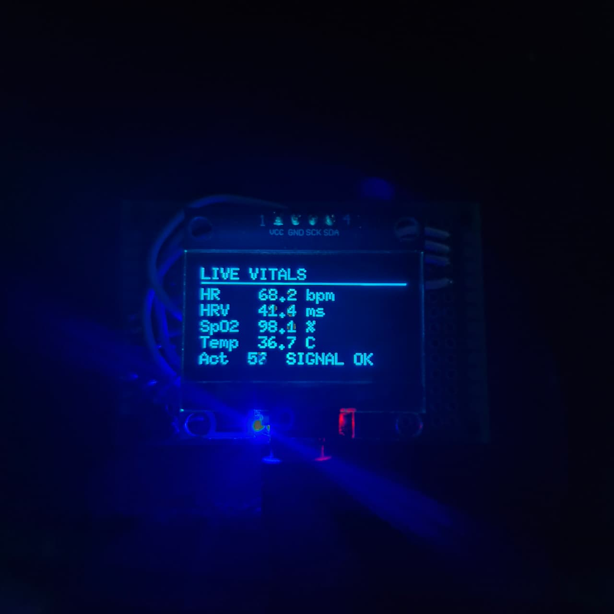
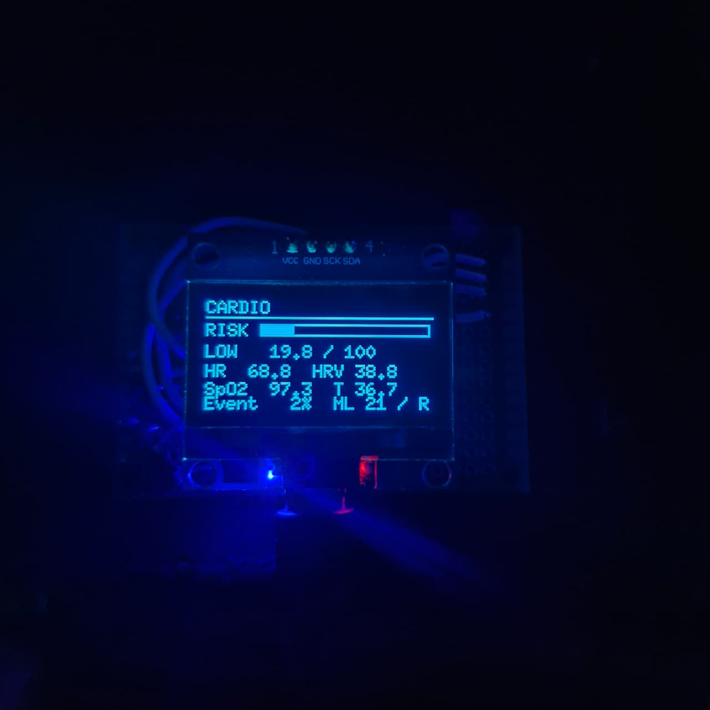
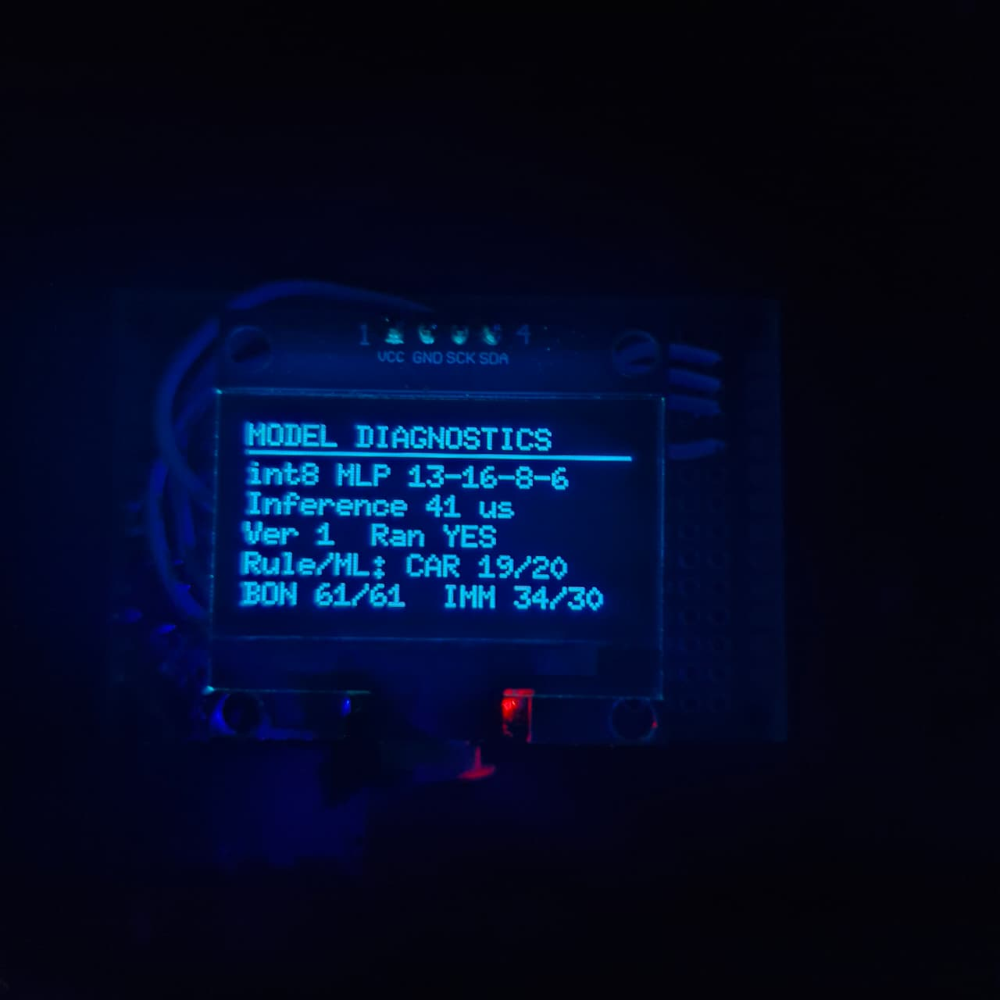
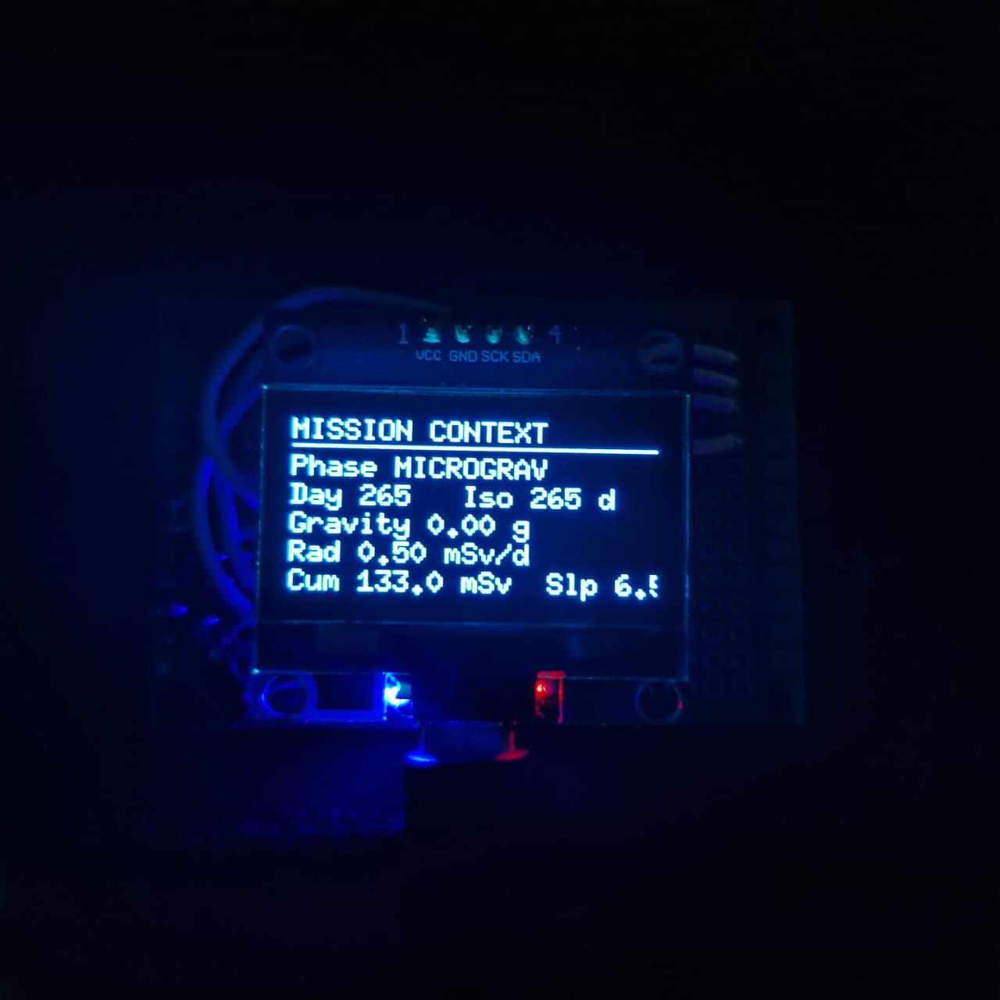
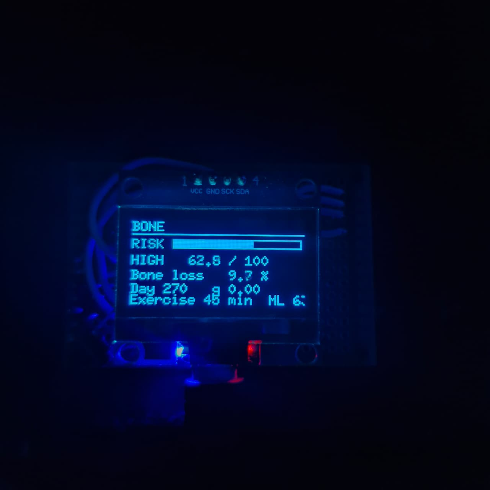
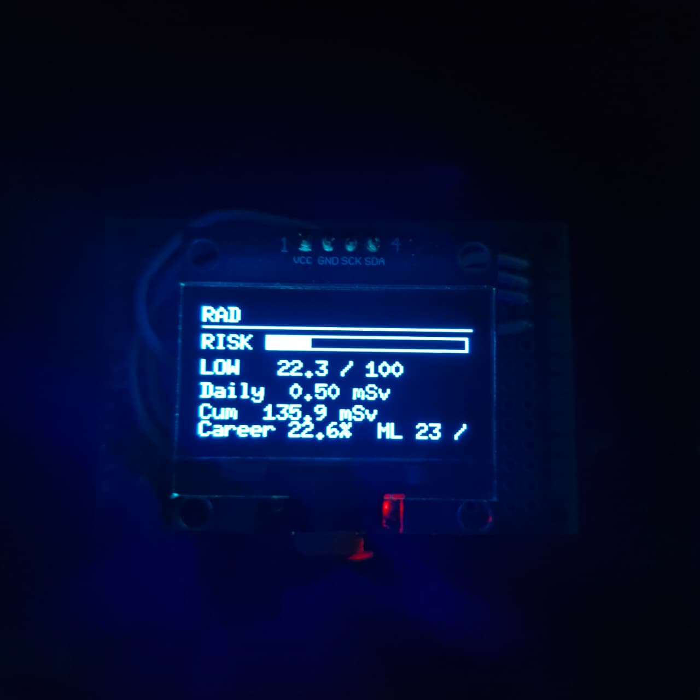
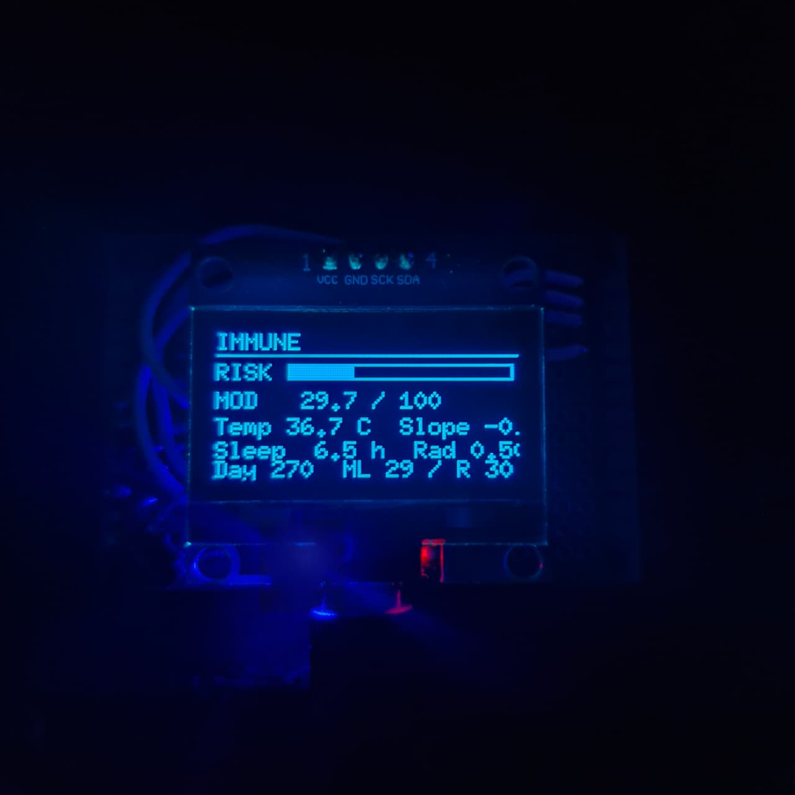
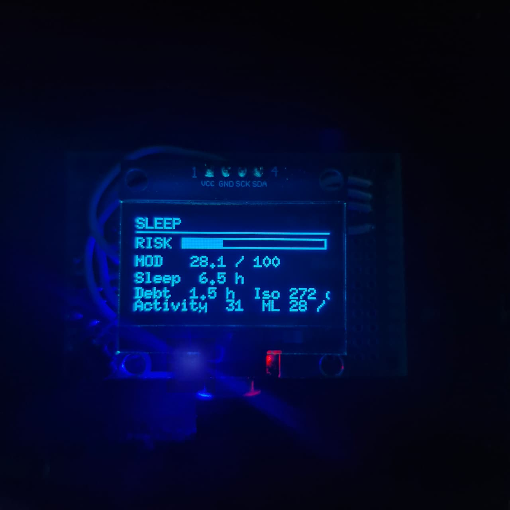
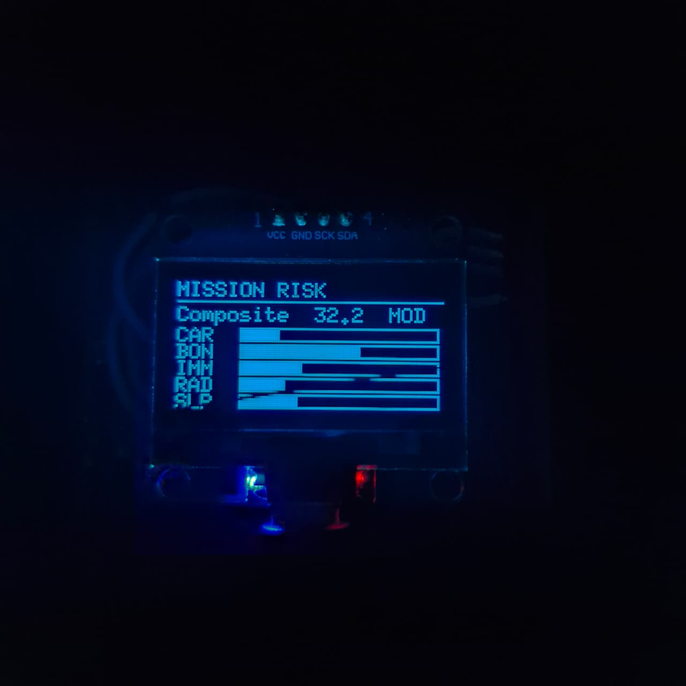

# HyperWatch: astronaut health & risk monitor

A wearable research prototype for the **NASA Space Apps 2026 "Create Health
Monitoring Software for Astronauts on Space Missions"** challenge.

HyperWatch turns an ESP32-S3 SuperMini + MAX30102 + TMP117 + MPU6050 +
SCD30/SCD40 + SH1106 watch into a five-domain astronaut health monitor with a
transparent rule engine, an **int8-quantised neural network running on-device**,
mission context, and ten OLED pages driven by one button.

The same model and risk engine run in the browser dashboard at
**<https://hyperlife.health>** through WebAssembly.

> ⚠️ **Research prototype, not a medical device.** It does not diagnose heart
> attacks, arrhythmias, bone density, or immune status. Every score is a
> research estimate. See [MODEL_CARD.md](MODEL_CARD.md) and the limitations
> section below.

| Live vitals | Cardiovascular | On-device model |
|---|---|---|
|  |  |  |

---

## The five risk domains

| # | Domain | NASA HRP risk it maps to | Primary signals |
|---|---|---|---|
| 1 | **Cardiovascular** | Risk of Cardiovascular Adaptations | HR, HRV proxy, SpO2, temperature, profile CVD |
| 2 | **Bone density / musculoskeletal** | Risk of Spaceflight-Induced Bone Changes | mission day, gravity, exercise, age |
| 3 | **Immune system** | Risk of Altered Immune System Responses | temperature + slope, sleep, radiation, duration |
| 4 | **Radiation exposure** | Risk of Radiation-Induced Cancers | daily dose, cumulative dose, phase |
| 5 | **Sleep / behavioural** | Isolation, confinement, sleep risk | sleep hours, mission day, activity |

Plus a derived **acute cardiac-event probability** (hybrid rules + ML) and a
composite mission risk index.

```
MAX30102 ─► HR / SpO2 ─┐
TMP117   ─► skin temp ─┤
MPU6050  ─► activity  ─┼─► Vitals ─► Rule engine ─┐
SCD30/40 ─► cabin CO2 ─┘                          ├─► fused risk ─► OLED + JSON + NVS
                       int8 MLP ──────────────────┘
```

---

## Hardware

| ESP32-S3 SuperMini | Device |
|---|---|
| GPIO 8 | SDA (all I2C devices) |
| GPIO 9 | SCL (shared I2C bus) |
| GPIO 10 | momentary button to GND |
| 3V3 | sensor/OLED VCC (check 3.3 V compatibility) |
| GND | common ground |

Expected I2C addresses: MAX30102 `0x57`, TMP117 `0x49`, MPU6050 `0x68` (or
`0x69` with AD0 high), SCD30 `0x61` / SCD40/SCD41 `0x62`, SH1106 `0x3C` or
`0x3D`. Full notes in [docs/wiring.md](docs/wiring.md).

### Libraries

- `U8g2`
- `Adafruit TMP117`
- `Adafruit Unified Sensor`
- `SparkFun MAX3010x Pulse and Proximity Sensor Library`
- `HyperWatchCore` (this repo; symlink or copy `firmware/HyperWatchCore` into
  `~/Arduino/libraries`)

No external library is required for the MPU6050 or the SCD30/SCD40: both use
small raw-I2C drivers (`MotionMonitor`, `CO2Monitor`) that ship with the sketch.

---

## Quick start

### Arduino CLI

```bash
# one-time: expose the shared core to the Arduino build
ln -sfn "$PWD/firmware/HyperWatchCore" ~/Arduino/libraries/HyperWatchCore

# target: ESP32-S3 SuperMini, 4 MB flash, USB CDC on boot
BOARD='esp32:esp32:esp32s3'
OPTS='FlashSize=4M,CDCOnBoot=cdc'

arduino-cli compile --fqbn "$BOARD" --board-options "$OPTS" firmware/HyperWatch_Production
arduino-cli upload  --fqbn "$BOARD" --board-options "$OPTS" -p /dev/ttyACM0 firmware/HyperWatch_Production
```

`CDCOnBoot=cdc` is required for USB serial telemetry on the SuperMini. The
firmware uses about **29 % of the 4 MB flash** and **10 % of RAM** on the
`esp32:esp32` 3.3.x core.

### Arduino IDE

1. Copy `firmware/HyperWatchCore` to `~/Arduino/libraries/HyperWatchCore`.
2. Open `firmware/HyperWatch_Production/HyperWatch_Production.ino`.
3. Select **ESP32S3 Dev Module**, the correct port, compile and upload.

---

## Controls

| Gesture | Action |
|---|---|
| Short press | next OLED page |
| Long press (1.2 s) | toggle "symptom reported" (chest pain / not feeling right) |

The mission clock advances one mission day per **10 real minutes**. Change
`DAYS_PER_SECOND` in the sketch to match a different mission profile.

Telemetry is printed as JSON over USB serial at **115200 baud**, so you can
record a dashboard alongside the OLED.

On the ESP32-S3 SuperMini's native USB, `arduino-cli monitor` can assert
DTR/RTS and hold the chip in reset, so the port looks silent. Use the bundled
reader, which deasserts both lines:

```bash
python3 tools/serial_monitor.py -p /dev/ttyACM0
```

### Mission/profile commands

The firmware accepts newline-terminated commands over USB serial (115200 baud).
Changes are applied immediately and saved to NVS on the next autosave.

| Command | Example | Meaning |
|---|---|---|
| `help` | `help` | list commands |
| `status` | `status` | print the current JSON snapshot |
| `crew <id>` | `crew ASTRO-07` | crew identifier |
| `age <years>` | `age 47` | crew age (18–80) |
| `cvd <0\|1>` | `cvd 1` | known cardiovascular disease |
| `phase <0..6>` | `phase 3` | mission phase (updates gravity + dose) |
| `day <n>` | `day 120` | mission day |
| `shield <factor>` | `shield 2.5` | shielding factor (0.1–10) |
| `sleep <hours>` | `sleep 7.5` | sleep in the last 24 h |
| `exercise <min>` | `exercise 60` | exercise in the last 24 h |
| `motion` | `motion` | print MPU6050 activity/steps/sleep state |
| `co2` | `co2` | print SCD30/SCD40 CO2 sensor state |
| `resetmotion` | `resetmotion` | clear the rolling 24 h motion ring |
| `reset` | `reset` | erase NVS and restore defaults |

---

## OLED pages (10)

| Page | Content |
|---|---|
| 0 | Splash / crew + phase + day + gravity + shielding |
| 1 | Mission context (phase, day, isolation, gravity, radiation, sleep) |
| 2 | Live vitals (HR, HRV, SpO2, temperature, activity, steps) |
| 3 | Cardiovascular risk + cardiac-event probability |
| 4 | Bone density risk + modelled bone loss |
| 5 | Immune risk + cabin CO2 / air quality |
| 6 | Radiation risk (daily, cumulative, % of 600 mSv reference) |
| 7 | Sleep / behavioural risk + steps |
| 8 | Composite mission risk + five bars + cardiac alert |
| 9 | Model diagnostics (int8 architecture, inference µs, rule vs ML) |

| Mission context | Bone | Radiation |
|---|---|---|
|  |  |  |

| Immune | Sleep | Mission risk |
|---|---|---|
|  |  |  |

---

## The model

- **Architecture:** `13 → 16 (ReLU) → 8 (ReLU) → 6 (sigmoid)`
- **Quantisation:** int8 weights + int8 activations, per-tensor scales, int32 accumulation
- **Size:** ~0.5 KB of weights/biases, ~1 KB flash total
- **Inference:** pure C, no runtime dependency; **41 µs** measured on the S3 and shown on page 9
- **Outputs:** cardio, bone, immune, radiation, sleep (0–100) + cardiac-event probability (0–1)

The displayed risk is **55 % rule engine + 45 % model**, so every number stays
traceable to named rules. Page 9 shows both sides of the fusion.

The identical `RiskEngine` and int8 weights are compiled to WebAssembly for the
[browser dashboard](https://hyperlife.health), so the watch and the site report
the same scores from the same inputs. See [MODEL_CARD.md](MODEL_CARD.md) for the
full model description and limitations.

`tools/verify_model.py` and `tools/verify_model.cpp` check that the committed
int8 header reproduces the C++ inference on a fixed feature vector:

```bash
python3 tools/verify_model.py                # needs numpy
g++ -std=c++17 -Itools/shim -Ifirmware/HyperWatchCore/src \
    tools/verify_model.cpp firmware/HyperWatchCore/src/RiskModel.cpp -o /tmp/verify_model
/tmp/verify_model
```

---

## Repository layout

```
HyperWatch/
  firmware/
    HyperWatchCore/          shared library (risk engine, model, mission context, pages)
    HyperWatch_Production/   sensor firmware + PPGMonitor + MotionMonitor + CO2Monitor
  tools/
    shim/Arduino.h           host-build shim for the C++ parity check
    serial_monitor.py        DTR/RTS-safe USB telemetry reader
    verify_model.py          int8 parity check (Python)
    verify_model.cpp         int8 parity check (C++)
  docs/
    wiring.md
    images/                  OLED captures from the wearable
  MODEL_CARD.md
  README.md
```

---

## Limitations & ethics

- Not a medical device; not validated for diagnosis or treatment.
- MAX30102 SpO2 is an uncalibrated experimental estimate.
- TMP117 measures local/contact temperature, not core body temperature.
- MPU6050 sleep and exercise are behavioural estimates, not clinical sleep staging.
- SCD30/SCD40 CO2 measures cabin air quality, not radiation.
- Bone, radiation, immune and blood-pressure values are **models/inputs**, not measurements.
- The cardiac-event output is a decision-support flag, not heart-attack detection.
- Rule weights and thresholds are illustrative, not clinical guidelines.
- Sex and race are **not** used as risk multipliers.
- No astronaut or patient records are stored or transmitted.

---

## NASA references

- [5 Hazards of Human Spaceflight](https://www.nasa.gov/hrp/hazards/)
- [Risks of Human Spaceflight](https://www.nasa.gov/hrp/risks/)
- [Risk of Cardiovascular Adaptations](https://www.nasa.gov/reference/risk-of-cardiovascular-adaptations/)
- [Risk of Spaceflight-Induced Bone Changes](https://www.nasa.gov/reference/risk-of-spaceflight-induced-bone-changes/)
- [Risk of Altered Immune System Responses](https://www.nasa.gov/reference/risk-of-altered-immune-system-responses/)
- [Space Apps 2026: Health Monitoring Software](https://www.spaceappschallenge.org/2026/challenges/health-monitoring-software/)

## License

MIT. See [LICENSE](LICENSE).
